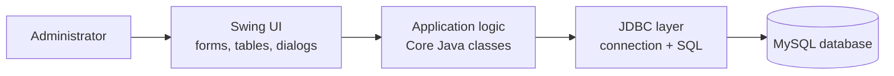
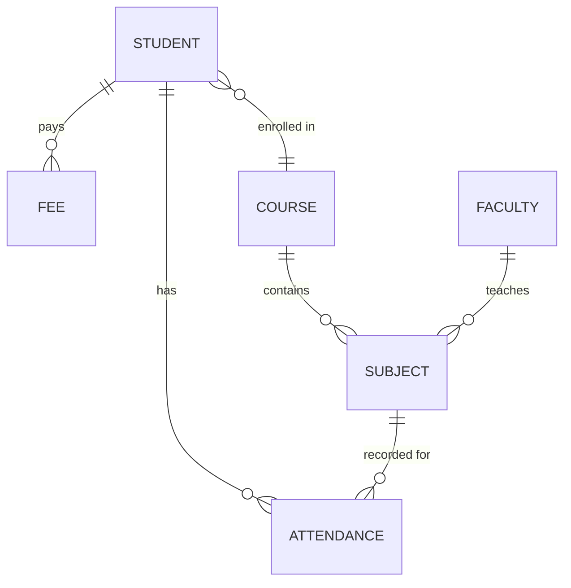

<!--
  Before publishing: search this file for "TODO" and replace every item with real
  project facts, then delete this comment. Do not publish estimates as metrics.
-->

<div align="center">

# College Management System

**A Java desktop application that centralizes student, faculty, course, attendance, fee and library records in a single MySQL-backed system.**


[Features](#features) · [Architecture](#architecture) · [Quick Start](#quick-start) · [Project Metrics](#project-metrics) · [Roadmap](#roadmap)

</div>

---

## Overview

Colleges often track students, attendance and fees across disconnected spreadsheets and paper registers, which leads to duplicate data, slow lookups and no single source of truth.

This project replaces that with one desktop application backed by a relational database. An administrator logs in and manages academic and administrative records through a Swing interface, with every operation persisted in MySQL through JDBC.

**What it demonstrates**

- Object-oriented design in Core Java
- Desktop GUI development with Swing
- Relational modelling and SQL with MySQL
- JDBC-based persistence and full CRUD workflows
- Database-backed search and record management

## Screenshots

> TODO: add 3-4 real screenshots under `docs/screenshots/` and link them here.

| Login | Dashboard / Main Window |
|---|---|
|  |  |

| Student Management | Fee / Attendance |
|---|---|
|  |  |

## Features

| Module | Capabilities | Status |
|---|---|---|
| **Authentication** | Admin login to gate access to the application | ✅ Implemented |
| **Student Management** | Add, view, update, delete and search student records | ✅ Implemented |
| **Faculty Management** | Maintain faculty information | TODO: ✅ Done / 🚧 In progress |
| **Course & Subject Management** | Maintain course and subject records | TODO: ✅ Done / 🚧 In progress |
| **Attendance** | Record and review attendance | TODO: ✅ Done / 🚧 In progress |
| **Fees** | Track fee payments and status | TODO: ✅ Done / 🚧 In progress |
| **Library** | Basic library record management | TODO: ✅ Done / 🚧 In progress |

Set each status honestly. Reviewers trust a README that says "in progress" more than one that overstates.

## Architecture

### System context



The application is a standalone desktop client that talks directly to a MySQL server. There is no separate application server, so deployment is "install Java, point it at a database".

### Design decisions

| Decision | Why | Trade-off |
|---|---|---|
| Desktop app with Swing | Ships with the JDK, no web server or browser needed, and suits a single administrative workstation | Not multi-user over a network without a shared DB; harder to modernize than a web UI |
| Plain JDBC (no ORM) | Full control of SQL, minimal dependencies, makes the data layer easy to learn and audit | More boilerplate; UI, logic and SQL are more tightly coupled than in a layered design |
| MySQL as the store | Relational data (students, courses, fees, attendance) maps naturally to tables with foreign keys | Requires a running DB server for every environment |

### Data model

> TODO: Align this with your actual schema (`database/schema.sql`). Add the real column names and keys.



## Tech Stack

| Layer | Technology |
|---|---|
| Language | Java (JDK 8 or later) |
| UI | Java Swing |
| Database | MySQL (8.x recommended) |
| Connectivity | JDBC with MySQL Connector/J |
| IDE | NetBeans / IntelliJ IDEA |

## Quick Start

### Prerequisites

- JDK 8 or later (`java -version`)
- MySQL Server running locally or in Docker
- MySQL Connector/J on the classpath

### 1. Clone

```bash
git clone https://github.com/Ragini-Roy7/college-management-system-using-swing.git
cd college-management-system-using-swing
```

### 2. Start MySQL

Use an existing server, or start a throwaway one with Docker:

```bash
docker run --name cms-mysql -e MYSQL_ROOT_PASSWORD=change_me \
  -e MYSQL_DATABASE=college_db -p 3306:3306 -d mysql:8.0
```

### 3. Create the schema

```bash
mysql -u root -p college_db < database/schema.sql
```

> TODO: confirm the SQL script path and name. If the repo has no script yet, export one with `mysqldump --no-data` and commit it so others can reproduce your database.

### 4. Configure the connection

Edit the connection class (TODO: actual class and file name):

```java
String url      = "jdbc:mysql://localhost:3306/college_db";
String username = "your_username";
String password = "your_password";
```

Never commit real credentials. Keep local values out of version control (see [Roadmap](#roadmap) for moving this to external config).

### 5. Run

**From an IDE:** open the project, add Connector/J to the classpath, and run the main class (TODO: main class name).

**From the command line:**

```bash
# Linux / macOS
javac -cp "lib/*" -d out $(find src -name "*.java")
java  -cp "out:lib/*" <MainClass>

# Windows (classpath separator is ;)
# java -cp "out;lib/*" <MainClass>
```

### 6. First login

> TODO: document the seeded admin account (username only, never a real password) and tell users to change it immediately.

## Project Structure

> TODO: replace with your real tree.

```text
college-management-system-using-swing/
├── src/                 # Java source: UI forms, logic classes, DB connection
├── lib/                 # MySQL Connector/J JAR
├── database/            # schema.sql (and sample data, if any)
├── docs/screenshots/    # README images
└── README.md
```

## Project Metrics

Real numbers make a project credible. Measure them yourself and fill the table. Leave a cell as "n/a" rather than guessing.

| Metric | Value | How to measure |
|---|---|---|
| Java source files | TODO | `find src -name "*.java" \| wc -l` |
| Lines of Java code | TODO | `cloc src` |
| Database tables | TODO | `mysql> SHOW TABLES;` |
| Functional modules | TODO | Count of rows marked ✅ in [Features](#features) |
| CRUD operations covered | TODO | Count distinct add/update/delete/search flows |
| Commits | TODO | `git rev-list --count HEAD` |
| Automated test coverage | 0% (no tests yet) | Update once tests exist |

## Engineering Notes

**Security**

- Use `PreparedStatement` for every query that takes user input to prevent SQL injection.
- Store passwords hashed (for example BCrypt), never as plain text.
- Keep database credentials out of the repository (`.gitignore` a local config file).

**Known limitations**

- UI, business logic and data access are not fully separated.
- Input validation and error handling are basic.
- No role-based access control (single admin role).
- No automated tests yet.

## Troubleshooting

| Symptom | Likely cause and fix |
|---|---|
| `ClassNotFoundException: com.mysql.cj.jdbc.Driver` | Connector/J is not on the classpath. Add the JAR to the IDE project or `-cp`. |
| `Communications link failure` | MySQL is not running, or host/port in the JDBC URL is wrong. |
| `Access denied for user` | Wrong username or password, or the user lacks privileges on the database. |
| `Public Key Retrieval is not allowed` | MySQL 8 auth. Add `?allowPublicKeyRetrieval=true&useSSL=false` to the URL for local development only. |
| `Unknown database` | The database was not created before running the schema script. |

## Roadmap

**Now: harden what exists**
- [ ] Externalize DB configuration (config file or environment variables)
- [ ] Audit all SQL for `PreparedStatement` usage
- [ ] Hash admin passwords
- [ ] Centralize input validation and user-facing error messages
- [ ] Add logging instead of printing stack traces

**Next: improve the design**
- [ ] Split into layers: `ui` → `service` → `dao` → `model`
- [ ] Introduce a build tool (Maven or Gradle) to manage Connector/J
- [ ] Add JUnit tests for the service and DAO layers
- [ ] Add a GitHub Actions workflow that builds and tests on every push

**Later: extend the product**
- [ ] Dashboard with academic and fee summaries
- [ ] Role-based access (admin, faculty, accounts)
- [ ] Export reports to CSV or PDF
- [ ] Docker Compose file for one-command database setup

## Contributing

Issues and pull requests are welcome. For larger changes, please open an issue first to discuss the approach.

## License

<!-- TODO: add a LICENSE file (MIT shown here) or remove this section and the badge. -->
Distributed under the MIT License. See `LICENSE` for details.

## Author

**Ragini Roy** · [GitHub](https://github.com/Ragini-Roy7) · [LinkedIn](https://linkedin.com/in/ragini-roy-56231b25a)

